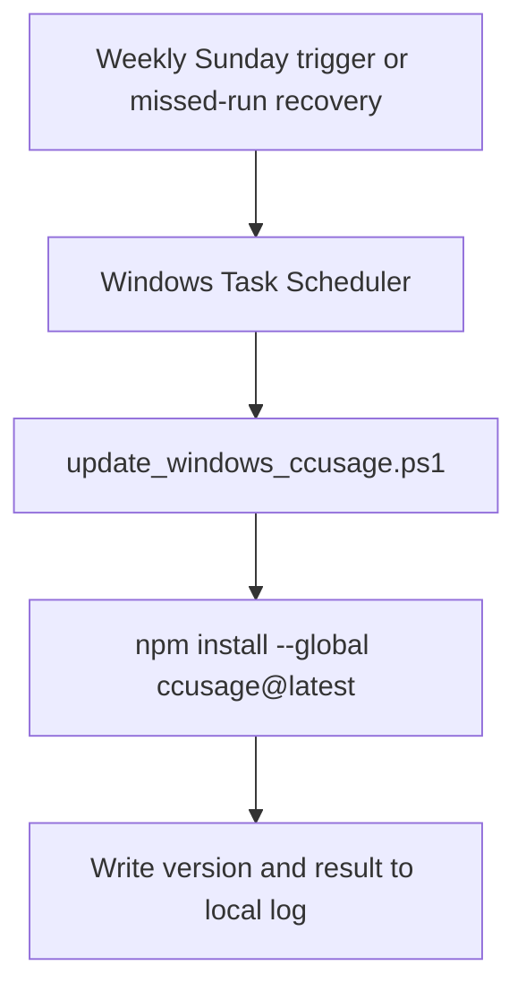

# ccusage 自動更新

此工作站使用 npm 全域安裝 `ccusage`。Windows 工作排程器每週日凌晨 3:00 執行 `npm install --global ccusage@latest`；若當時未登入，工作會在下次登入後補跑。更新輸出記錄於 `%LOCALAPPDATA%\ccusage\auto-update.log`。

此工作只更新目前 npm/Node 安裝中的全域套件，不會更新 Node.js，也不會影響 `TY Multiverse AI Usage Sync` 資料同步工作。全域 npm 套件依 Node 版本分開安裝；若用 NVM 切換 Node 版本，請在新的版本環境重新執行安裝腳本，以更新工作排程使用的 npm 路徑。

安裝或更新工作排程：

```powershell
.\scripts\install_windows_ccusage_auto_update_task.ps1
```

立即手動更新：

```powershell
$npm = (Get-Command npm.cmd -ErrorAction Stop).Source
.\scripts\update_windows_ccusage.ps1 -NpmPath $npm
```

檢查套件版本與工作排程：

```powershell
ccusage --version
Get-ScheduledTask -TaskName "ccusage Auto Update"
Get-ScheduledTaskInfo -TaskName "ccusage Auto Update"
```



## 開發方法

工作排程安裝器從目前使用者的 PATH 解析 `npm.cmd`，並將其絕對路徑傳給更新腳本，避免排程工作依賴互動式 shell 的 PATH。更新腳本檢查 npm 執行結果、記錄輸出與版本，失敗時保留非零錯誤並寫入同一記錄檔。排程使用目前使用者的互動式登入權杖、每週日 03:00 觸發，並啟用 missed-run recovery；安裝器可重複執行以更新既有排程。
