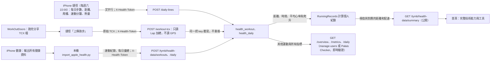
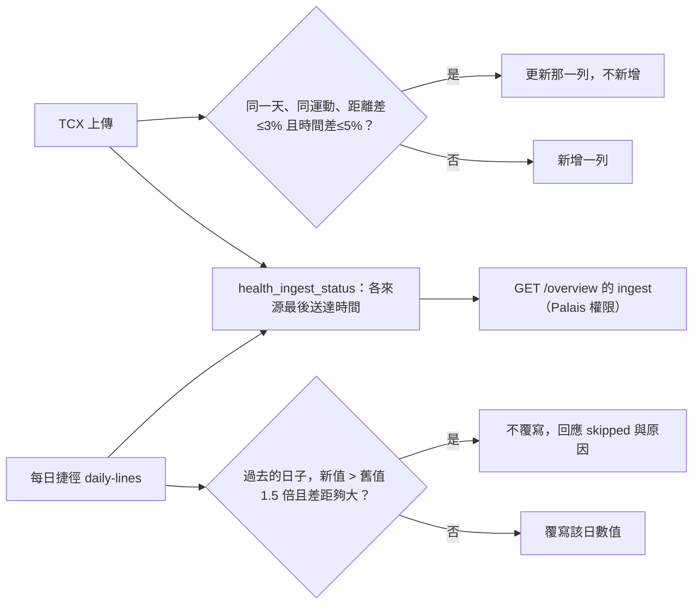
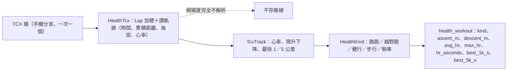
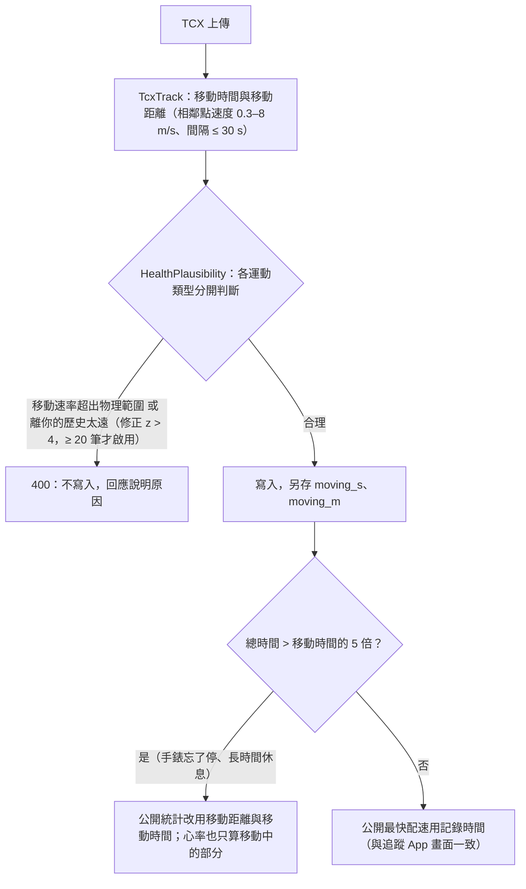

# Apple 健康資料匯入與公開統計

## 做什麼、何時觸發
手動匯出 iPhone「健康」資料，在本機解析後送到後端；首頁公開跑步與活動統計。每日數值由 iPhone 捷徑每週自動補上；每次運動則在跑完後從 WorkOutDoors 分享 TCX 檔到捷徑（2026-11-24）。

## 架構圖

## 憑證
`HEALTH_INGEST_TOKEN`：K8s Secret `health-data-credentials`（deployment 以 envFrom 讀取，optional）。未設定時一律拒絕寫入。

## 測試
`./mvnw test -Dtest='RunningStatsTest,HealthDataSecurityWebTest,SecurityRulesWebTest'`；`python3 -m unittest discover -s scripts/tests -p test_import_apple_health.py`。
已知缺口：SQL 未在真實 PostgreSQL 上自動測試；解析器只用合成資料。

## 開發方法（2026-11-23）
1. 用 Apple 匯出而不用 Strava API：Strava 條款只准把資料顯示給本人，快取上限 7 天。
2. 匯入所有數值與類別紀錄，存「每日彙總」而非逐筆。不匯入 GPS 路線、心電圖、病歷檔，也不匯入生殖與月經相關資料（擁有者決定；心房顫動照存）。不存開始時間與裝置名稱。
3. （2026-11-23 改）只公開跑步統計；其他運動與所有指標給擁有者和 Palais Checker（`PalaisReadGuard` 每次向 Keycloak 確認，撤權立即生效）。畫面標註 Powered by Apple Health。
4. 手機和手錶會重複計步，累積型指標每天取總量最高的單一來源，是近似值。
5. 同一趟運動若由兩個 App 寫入，重疊超過一半視為同一筆，優先 Apple Watch。
6. 最快配速至少 3 km；週從星期一算（Asia/Taipei）。
7. 上線順序：`db/health_data.sql`、Secret、部署後端、匯入（先不加 `--apply`）、部署前端。重複匯入會覆寫，不會重複；來源刪除的資料不會自動刪。

## 開發方法（2026-11-26）
1. 摘要沿用每次活動已儲存的平均心率、爬升、距離及時間。最低平均心率取跑步，最大爬升取跑步與健行。零值與缺值不參與比較。
2. 在 `records.prs` 加入 `lowestAvgHr`，並為這筆紀錄和 `mostAscentM` 提供 `longest`（公里）與 `fastest`（秒／公里）。依原始數值判定並列後，分別選最長距離與最快平均配速，日期用於辨識兩次活動。有距離但缺有效時間時省略 `fastest`。
3. `RunningRecordsTest` 先驗證並列時兩個得主可能不同，再覆蓋心率缺值、健行排除與缺時間。執行 `./mvnw test`。前端 `tests/home/healthRecord.test.ts` 驗證中英文與連續狀態。
4. 沿用既有資料表與憑證。先部署後端並確認摘要的新欄位，再部署前端。新前端可讀取舊版摘要。

## iPhone 捷徑：每週六 22:00 更新每日數值（2026-11-23）
捷徑無法可靠讀取單次跑步，所以公開的跑步統計仍靠匯出檔更新；捷徑只更新每日的步數、距離、爬樓、運動時間與熱量。

**重要：來源要過濾。** 捷徑的「尋找健康樣本」分組只是把所有來源加總，不會像健康 App 去重。實測 2026-11-16：手錶 4940 ＋ iPhone 5432 ＝ 10372，比實際多一倍。步數、距離、爬樓每個動作都要加「來源 是 iPhone」；運動分鐘與動態能量只有手錶會記，不用過濾。

**實際做法（2026-11-24）：每個指標一個捷徑**（匯出健康資料＝步數、匯出距離、匯出爬樓、匯出運動分鐘、匯出熱量），各自 POST 一次；同一個自動化放 5 個「執行捷徑」。分開送是因為後端按 (指標, 日期) 覆寫，不需要合併。單位選項要先改類型才會出現（例如先選「步行＋跑步距離」才有公里）。標題欄用英文鍵盤手打 `X-Health-Token`、token 用複製貼上，夾了全形字元或尾端空白會讓 ingress 直接回 400。

每個指標一組：
1. 尋找健康樣本：類型、開始日期為最近 8 天、單位、分類方式＝天、來源＝iPhone。
2. 重複每個項目，裡面放一個「文字」：`指標名稱,開始日期,重複項目`。指標名稱：`StepCount`、`DistanceWalkingRunning`、`FlightsClimbed`、`AppleExerciseTime`、`ActiveEnergyBurned`。開始日期用重複項目的「開始日期」屬性，單位由後端從數值文字（例如 `8912 count`、`5.2 公里`）辨識並統一。
3. 全部指標跑完後「合併文字」（預設換行），再用「取得 URL 內容」POST 到 `https://tymultiverse.cc/tymb/health-data/daily-lines`，標頭 `X-Health-Token`，要求內文選檔案＝合併文字。後端逐行解析，格式不對會回 400 並指出第幾行。
4. 自動化：一天中的時間 22:00、每週、星期六、立即執行。鎖定時讀不到健康資料，執行時手機要解鎖。送過去 8 天是為了補齊上週未完的日子；重送會覆寫，不會重複。

文字行是純文字而非 JSON，是因為捷徑的文字欄位會把引號轉成彎引號、數字帶千分位、日期隨地區變化。

## WorkOutDoors 分享 TCX：每次跑步自動更新首頁成績（2026-11-24）
**開發方法（為什麼這樣做）**
1. 捷徑的「尋找健康樣本」沒有「體能訓練」類型，讀不到單次運動；用「跑步速度」推算每日跑步，與匯出檔相比誤差中位數約 9.7%，且沒有跑步距離（週累積、單日高峰算不出來），不採用。
2. 付費路線都不採用：Health Auto Export 的 REST API 要 Premium；Strava API 只開放給訂閱者，且條款只准顯示給本人。
3. 採用 WorkOutDoors 的「Share TCX file」：TCX 的每個 Lap 有 `TotalTimeSeconds` 與 `DistanceMeters`，加總與 App 畫面一致（實測一次 16.55 km、5:48:18）。GPX 沒有總數、FIT 要另外的解析套件，所以選 TCX。
4. 後端串流解析，遇到 `Track`（GPS 軌跡點，約占檔案 99%）整段跳過，不讀、不存座標。拒絕 DOCTYPE（防外部實體）。請求大小上限 30 MB。
5. 去重：key 與匯入腳本相同，`sha256("<activity>|<開始時間的 epoch 秒>")`；Sport `Biking` 對應成 `Cycling`。已經由 Apple 匯出匯入的運動會被同一列覆寫（已用真實資料驗證 key 相同），所以不會重複。
6. 不從 TCX 取熱量：TCX 的 `Calories` 含基礎代謝（實測 1333），匯入存的是活動能量（878），語意不同；已存在的熱量保留不動（`saveWorkoutsKeepingEnergy`）。
7. 日期用 Asia/Taipei 的日曆日。
8. 上傳端點在 Spring Security 放行（`permitAll`），由 `X-Health-Token` 驗證，與其他寫入端點一致。

**使用**：WorkOutDoors → 該次運動 → Export → Share TCX file → 選捷徑「上傳跑步」。捷徑：「接收捷徑輸入（檔案）」→「取得 URL 內容」POST 到 `https://tymultiverse.cc/tymb/health-data/workout-tcx`，標頭 `X-Health-Token`，要求內文＝檔案（捷徑輸入）。成功回 `saved`、`activity`、`day`、`distanceM`、`durationS`。

**注意**：`tymultiverse.cc/tymb` 的 Ingress 需要 `nginx.ingress.kubernetes.io/proxy-body-size`（預設 1 MB，一小時以上的運動會超過而回 413），設定在 `peoplesystem-terraform-oke/tymultiverse-domain/mirror-ingress.yaml`。

## 防止重複與翻倍（2026-11-24）
新舊兩條寫入路徑（匯出檔、每日捷徑、TCX 上傳）可能對同一天、同一場運動各寫一次，所以後端有三道防線：

1. **同一場運動不重複**（`HealthWorkoutMatch`）：匯出檔與 TCX 的開始秒數可能不同，key 就不同。同一天同種運動，若距離差 ≤ 3% 且時間差 ≤ 5%，視為同一場，更新原本那一列。用正式資料檢查過：同一天的多場運動差異都在 14% 以上，不會被誤併。
2. **每日數值不翻倍**（`DailyGuard`）：只擋「過去的日子」且新值大於舊值 1.5 倍、增加量也超過該指標的下限（步數 500、距離 1 km、熱量 50、運動 10 分鐘、爬樓 5 層）。變小一律放行；今天還在增加所以放行。被擋的會在 `daily-lines` 回應的 `skipped`、`skippedDetails` 說明，不覆寫原值。起因是手錶加手機同時計步會變兩倍（實測 10372 對 5432）。
3. **心跳**（`health_ingest_status`）：每次成功寫入記錄來源與最後送達時間。每日捷徑「每個指標一列」（`daily-lines:StepCount`、`daily-lines:DistanceWalkingRunning`、`daily-lines:FlightsClimbed`、`daily-lines:AppleExerciseTime`、`daily-lines:ActiveEnergyBurned`），所以其中一個捷徑悄悄停了也看得出來；另有 `workout-tcx`、`apple-export`。每列有筆數與最新日期；整批都被防翻倍略過也算送達，`/health-data/overview` 的 `ingest` 帶 `age_hours`。寫入失敗不影響上傳（資料表剛部署時可能還沒建）。

**不做的檢查**：曾考慮「當天步行＋跑步距離總和 ≥ 當天所有運動距離」，但實測 2026-11-21 健行 16.55 km 大於當天步行跑步距離 13.10 km（兩者的來源不同），這個不變量不成立，所以不採用。

**限制**：新的 SQL 沒有在真實 PostgreSQL 上自動測試（已用唯讀查詢在正式庫手動確認語法）；天數窗口「最近 N 天」是按整天算，N 天會寫入 N+1 筆（含今天）。排程每 2 天跑一次時建議 N = 4，才能容忍漏跑一次。

## 越野跑與心率：從 TCX 軌跡取出的指標（2026-11-24）

**開發方法（為什麼這樣做）**
1. 擁有者是越野跑玩家、心率重要、且決定**心率公開**。公開範圍是「跑步類運動的單次摘要」（平均／最高心率、心率區間）；Apple 健康的每日心率、靜止心率、HRV、心房顫動維持只有擁有者與 Palais Checker 可看。
2. **只存摘要，不存路線**：解析器只讀時間、累積距離、海拔、心率，經緯度元素從不解析。心率存「每 5 bpm 的秒數直方圖」（`hr_seconds`，例如 `{"150": 3200}`），之後改最大心率或區間定義都能重算，不必重傳檔案。
3. **心率**：時間加權平均，間隔上限 10 秒；30–230 以外的值（0 是感測器斷訊）排除。
4. **爬升／下降**：海拔變化要超過 2.5 m 才累計（磁滯），濾掉 GPS／氣壓雜訊。用真實健行校正：算出 327／452，WorkOutDoors 畫面 336／459（差 2.7%／1.5%）。越野跑資料多了再校正門檻。
5. **最快 1／5 公里**：滑動視窗找最短時間。曾經未過濾得出「2:04 每公里」（GPS 跳點）；現在超過 30 秒的間隔或速度超過 8 m/s 的步進不計距離（但時間照算），所以雜訊只會讓成績變慢，不會產生不可能的紀錄。真實健行為 11:31／97:00。
6. **嚴格分類 `kind`**（`HealthKind`）：以你在 WorkOutDoors 選的運動為準；跑步依爬升再分，爬升 ≥ 300 m，或 ≥ 3 km 且每公里爬升 ≥ 25 m 為 `TrailRun`，否則 `RoadRun`；`Hiking`→`Hike`、`Walking`→`Walk`、`Cycling`→`Ride`、其餘 `Other`。沒有海拔資料的跑步（Apple 匯出的舊紀錄）只會是 `Run`，上傳 TCX 後才分得出。門檻是預設，待實際越野跑校正。
7. **步頻不採用**：`RunCadence` 含 0 值、單位不明，與 WorkOutDoors 畫面對不上。
8. 資料表欄位要先套用 `db/health_data.sql` 的 `ALTER TABLE`，否則 TCX 上傳會直接失敗（不會悄悄丟掉心率）。

**驗證**：`mvn test -Dtest=HealthTcxRealFileTest -Dtcx.sample=<tcx路徑>` 用真實檔案對照畫面數字（檔案含 GPS，不進 Git；沒給路徑時略過）。

## 失真防護：不合理的速率不記，計時器壞掉的運動照記（2026-11-24）

**為什麼不用「總時間的速率超過幾個標準差就丟」**：真的越野跑（10/17：10.56 km、3:52、爬 849 m）有長時間休息，總時間速率比一般跑步慢很多；忘了停錶的跑步（10/15：9.15 km、計時 19:26）也一樣怪，但兩者都是真的運動。所以改用「移動時間」判斷速率，運動本身保留。

1. **物理範圍（移動平均速率，各運動分開，騎車獨立一組）**：跑步 2–22、健行 0.8–9、步行 1–8、騎車 3–45 km/h。沒有移動時間（只有 Lap 的檔案）時只檢查上限，因為總時間算出的速率不可能比移動速率快。
2. **離群值用 MAD 不用標準差**：歷史資料裡本來就有離群值，會把標準差拉大。對速率取對數後算修正 z 分數（`0.6745 × (x − 中位數) / MAD`），超過 4 就擋；同一種運動至少有 20 筆移動速率才啟用，之前只看物理範圍。歷史只拿同一種運動，騎車的速度不會讓跑步的 16 km/h 變成正常。
3. 速率不合理的上傳回 400，訊息說明是哪種運動、算出幾 km/h、合理範圍；**不寫入**，所以不會污染統計。
4. 欄位 `moving_s`、`moving_m`（`db/health_data.sql`）。總時間超過移動時間 **5 倍**（手錶忘了停）時，`GET /summary` 的最快配速、累計距離與週圖改用移動距離和移動時間，心率平均與直方圖也只算移動中的部分；其餘維持記錄的數字（與追蹤 App 畫面一致）。門檻取 5 倍是因為正常運動的總時間約是移動時間的 1.2–3 倍（真實健行 2.03 倍），而且移動距離會低估（健行為總距離的 67%：慢速步進與超過 30 秒的間隔被排除），只適合極端情況。舊的 Apple 匯出資料沒有這兩個欄位，維持原樣。

**10/15 這場跑步的教訓**：Lap 距離 9.15 km、計時 19:26。心率直方圖顯示真正在跑（105 bpm 以上）只有約 40 分鐘，最快 1 公里 6:13，但「9.15 km ÷ 移動時間」卻是每公里 4:21，兩者矛盾：手錶停在原地 19 小時，GPS 漂移把距離一直加上去。所以光修時間不夠，距離也要用移動距離，速率才自洽。這也是為什麼速率檢查要用「移動距離 ÷ 移動時間」。
