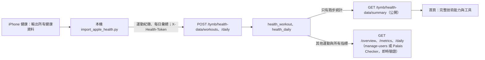

# Apple 健康資料匯入與公開統計

## 做什麼、何時觸發
手動匯出 iPhone「健康」資料，在本機解析後送到後端；首頁公開跑步與活動統計。

## 架構圖

## 憑證
`HEALTH_INGEST_TOKEN`：K8s Secret `health-data-credentials`（deployment 以 envFrom 讀取，optional）。未設定時一律拒絕寫入。

## 測試
`./mvnw test -Dtest='RunningStatsTest,HealthDataSecurityWebTest,SecurityRulesWebTest'`；`python3 -m unittest discover -s scripts/tests -p test_import_apple_health.py`。
已知缺口：SQL 未在真實 PostgreSQL 上自動測試；解析器只用合成資料。

## 開發方法（2026-11-23）
1. 用 Apple 匯出而不用 Strava API：Strava 條款只准把資料顯示給本人，快取上限 7 天。
2. 匯入所有數值與類別紀錄，存「每日彙總」而非逐筆。不匯入 GPS 路線、心電圖、病歷檔，也不匯入生殖與月經相關資料（擁有者決定；心房顫動照存）。不存開始時間與裝置名稱。
3. （2026-11-23 改）只公開跑步統計；其他運動與所有指標給擁有者和 Palais Checker（`PalaisReadGuard` 每次向 Keycloak 確認，撤權立即生效）。畫面標註 Powered by Apple Health。
4. 手機和手錶會重複計步，累積型指標每天取總量最高的單一來源，是近似值。
5. 同一趟運動若由兩個 App 寫入，重疊超過一半視為同一筆，優先 Apple Watch。
6. 最快配速至少 3 km；週從星期一算（Asia/Taipei）。
7. 上線順序：`db/health_data.sql`、Secret、部署後端、匯入（先不加 `--apply`）、部署前端。重複匯入會覆寫，不會重複；來源刪除的資料不會自動刪。

## iPhone 捷徑：每週六 22:00 更新每日數值（2026-11-23）
捷徑無法可靠讀取單次跑步，所以公開的跑步統計仍靠匯出檔更新；捷徑只更新每日的步數、距離、爬樓、運動時間與熱量。

**重要：來源要過濾。** 捷徑的「尋找健康樣本」分組只是把所有來源加總，不會像健康 App 去重。實測 2026-11-16：手錶 4940 ＋ iPhone 5432 ＝ 10372，比實際多一倍。步數、距離、爬樓每個動作都要加「來源 是 iPhone」；運動分鐘與動態能量只有手錶會記，不用過濾。

每個指標一組：
1. 尋找健康樣本：類型、開始日期為最近 8 天、單位、分類方式＝天、來源＝iPhone。
2. 重複每個項目，裡面放一個「文字」：`指標名稱,開始日期,重複項目`。指標名稱：`StepCount`、`DistanceWalkingRunning`、`FlightsClimbed`、`AppleExerciseTime`、`ActiveEnergyBurned`。開始日期用重複項目的「開始日期」屬性，單位由後端從數值文字（例如 `8912 count`、`5.2 公里`）辨識並統一。
3. 全部指標跑完後「合併文字」（預設換行），再用「取得 URL 內容」POST 到 `https://tymultiverse.cc/tymb/health-data/daily-lines`，標頭 `X-Health-Token`，要求內文選檔案＝合併文字。後端逐行解析，格式不對會回 400 並指出第幾行。
4. 自動化：一天中的時間 22:00、每週、星期六、立即執行。鎖定時讀不到健康資料，執行時手機要解鎖。送過去 8 天是為了補齊上週未完的日子；重送會覆寫，不會重複。

文字行是純文字而非 JSON，是因為捷徑的文字欄位會把引號轉成彎引號、數字帶千分位、日期隨地區變化。
