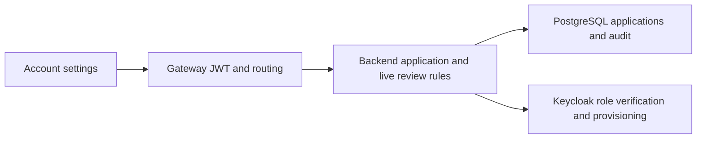
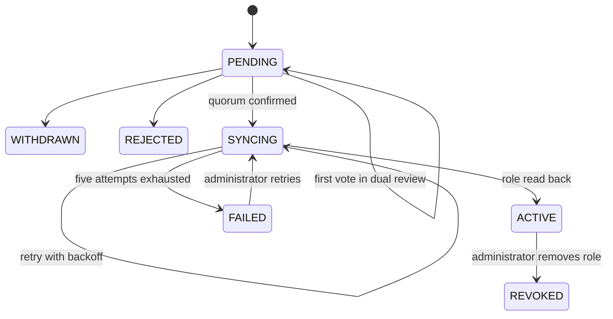

# Palais access and review

An authenticated member can request Palais access and the ability to review applications. In single-review mode only the configured initial Checker can decide requests. Two-review mode requires two distinct active Checkers. The quorum is recorded on submission, so enabling dual review affects newly submitted applications.

## 開發方法

1. Run the review-policy tests and Backend controller tests with `./mvnw test`. The controller tests use a mocked Keycloak client. Exercise the SQL migration and worker in a staging PostgreSQL instance before production activation.
2. Apply `db/palais_access.sql` using the existing database migration identity. Grant the runtime identity the request-table and sequence privileges, plus only SELECT and INSERT on the audit table. Keep the feature disabled until the migration is verified.
3. In an isolated realm, create the direct realm role `palais-checker`, configure the API audience claim on the login client, and create a Backend service account for role lookup and mapping. Verify assignment, read-back and removal, including rejected attempts to map other roles. Use the existing PeopleSystem SSO in production and pin the exact issuer and audience observed in signed access tokens. Assign the role directly to the verified Chiaki account for bootstrap.
4. Configure the Backend with `PALAIS_ACCESS_INITIAL_CHECKER_ID`, `PALAIS_ACCESS_ISSUER`, `PALAIS_ACCESS_AUDIENCE` and `PALAIS_ACCESS_CLIENT_ID`. Supply `PALAIS_ACCESS_CLIENT_SECRET` from Jenkins into the optional Kubernetes Secret `palais-access-credentials` in the Backend namespace. Put non-secret settings in `palais-access-config`. Keep the value out of Git and test fixtures. The worker logs failed provisioning by request ID and records the event in the administrator audit view.
5. Deploy API routing and client changes. Enable with `PALAIS_ACCESS_ENABLED=true` after configuration and migration verification. Test submission, approval, opening Palais, manager-only actions, and revocation using a pre-revocation token. Verify the Palais workflow before publishing its BPMN diagram.

The initial Checker ID is the realm user UUID carried in the JWT subject. If that account loses the direct role, a realm administrator must restore it after reviewing the audit history. Before enabling the feature, verify that the role service account cannot map unrelated roles. Maya uses the internal Backend verifier for sensitive reads made with the new role, so a revoked Checker gets denied even with an older signed token. Set PALAIS_ACCESS_VERIFICATION_URL in Maya for deployments with a different Backend service address.
## What a Checker can reach (inventory, 2026-11-20)

Read from the code of all four repos; nothing was run. A Checker is a logged-in account holding the realm role `palais-checker`, confirmed live by `GET /palais-access/verify-read` for every Maya read below.

| Palais piece | Calls | Role it requires | Checker |
|---|---|---|---|
| `/palais` landing: AI visibility panel | Maya `GET /market/admin/ai-visibility` (`owner_view`) | `manage-users` or `palais-checker` | allowed |
| Portfolio and history (`/api/market/portfolio`, `history`, `research-economics`) | Maya `GET /market/portfolio`, `/market/internal/portfolio/history` | `manage-users` or `palais-checker` | allowed |
| North-star reader metrics | Maya `GET /market/internal/north-star` | `manage-users` or `palais-checker` | allowed |
| Keycloak administration console card | link to the SSO admin console | Keycloak's own admin roles | hidden for Checkers (`data-palais-admin`) |
| IBKR snapshot, usage, custom dashboard, dismiss watch, automation check and the other `/market/*` admin routes | Maya | `manage-users` only | refused (403) |
| `fight`, `group`, `dance`, `party`, `levels` pages | static pages; `group` also posts to the frontend's own `/api/local-character-download` and `/api/save-character-image` | page itself has no API role; the two save routes only work on a macOS host and take no token | page opens; saving is a local-machine feature |
| `live` page | Maya `POST /maya-sawa/videos/merge-videos` | none (pre-existing, unauthenticated) | unchanged |

Follow-ups this inventory found:

- `merge-videos` has no authentication at all, for anyone; it predates this feature and is not a Checker matter.
- The pages themselves are only hidden by `NavScript` (redirect to `/account-settings`); the data is protected by the APIs above, so the table is the real boundary. Re-run this inventory whenever a Palais module gains an API call.
- The pending-request vote count shown in the UI counts every APPROVE not yet marked invalid, so a revoked Checker's vote is still displayed until the next decision recounts it. The decision itself recounts against live roles.
