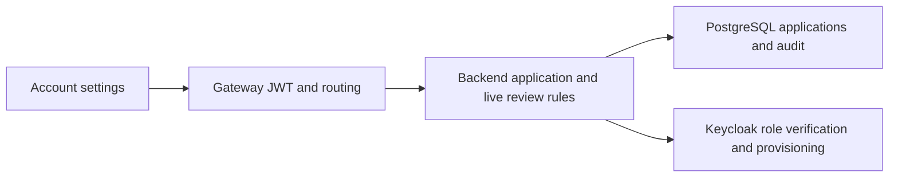
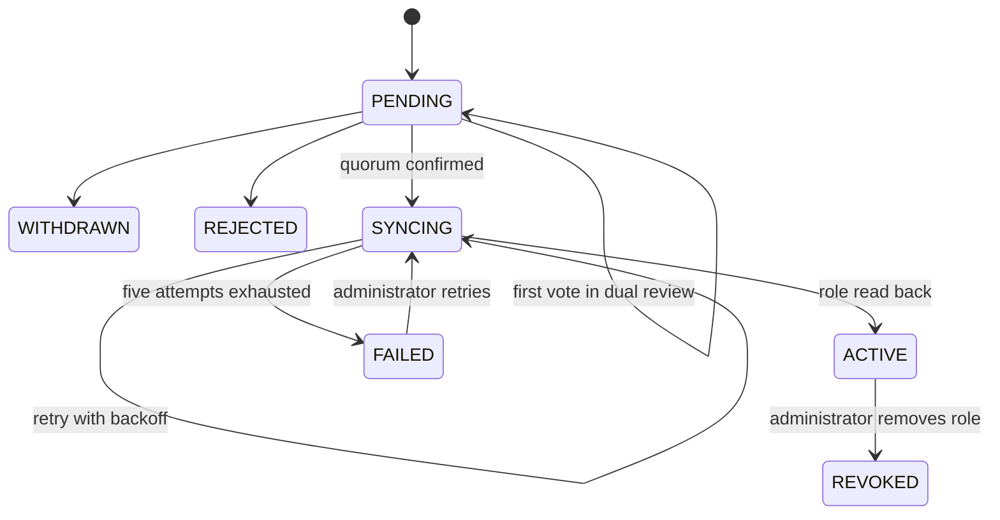

# Palais access and review

An authenticated member can request Palais access and the ability to review applications. In single-review mode only the configured initial Checker can decide requests. Two-review mode requires two distinct active Checkers. The quorum is recorded on submission, so enabling dual review affects newly submitted applications.

## 開發方法

1. Run the review-policy tests and Backend controller tests with `./mvnw test`. The controller tests use a mocked Keycloak client. Exercise the SQL migration and worker in a staging PostgreSQL instance before production activation.
2. Apply `db/palais_access.sql` using the existing database migration identity. Grant the runtime identity the request-table and sequence privileges, plus only SELECT and INSERT on the audit table. Keep the feature disabled until the migration is verified.
3. In an isolated realm, create the direct realm role `palais-checker`, configure the API audience claim on the login client, and create a Backend service account for role lookup and mapping. Verify assignment, read-back and removal, including rejected attempts to map other roles. Use the existing PeopleSystem SSO in production and pin the exact issuer and audience observed in signed access tokens. Assign the role directly to the verified Chiaki account for bootstrap.
4. Configure the Backend with `PALAIS_ACCESS_INITIAL_CHECKER_ID`, `PALAIS_ACCESS_ISSUER`, `PALAIS_ACCESS_AUDIENCE` and `PALAIS_ACCESS_CLIENT_ID`. Supply `PALAIS_ACCESS_CLIENT_SECRET` from Jenkins into the optional Kubernetes Secret `palais-access-credentials` in the Backend namespace. Put non-secret settings in `palais-access-config`. Keep the value out of Git and test fixtures. The worker logs failed provisioning by request ID and records the event in the administrator audit view.
5. Deploy API routing and client changes. Enable with `PALAIS_ACCESS_ENABLED=true` after configuration and migration verification. Test submission, approval, opening Palais, manager-only actions, and revocation using a pre-revocation token. Verify the Palais workflow before publishing its BPMN diagram.

The initial Checker ID is the realm user UUID carried in the JWT subject. If that account loses the direct role, a realm administrator must restore it after reviewing the audit history. Before enabling the feature, verify that the role service account cannot map unrelated roles. Maya uses the internal Backend verifier for sensitive reads made with the new role, so a revoked Checker gets denied even with an older signed token. Set PALAIS_ACCESS_VERIFICATION_URL in Maya for deployments with a different Backend service address.