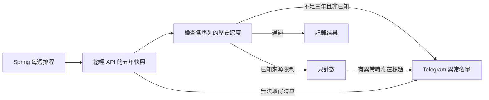

# 產品資料完整性監控與 BPMN

Spring Boot 每週一台北時間 11:00 讀取一次 Maya Sawa 的總經 API，窗口為 60 個月。每條序列取有效、非未來的最早資料點，跟今天比是否滿三年（容許 7 天，正好三年前開始的不算不足），無有效值也回報。期別支援 `YYYY`、`YYYY-Qn`、`YYYY-MM`、`YYYY-MM-DD`。

來源本身只給短期資料的序列列在 `MacroHistoryCheck.KNOWN_SHORT`，與 maya-sawa `docs/MACRO_DATA_INTEGRITY.md` 同步維護。這些只在訊息標題計數，不逐條列出；0 點時仍算需處理。只有出現需處理的序列才發 Telegram，列出代號、名稱、日期與點數；API 失敗另發通知。

## 開發方法

1. 沿用圖表使用的快照，一次請求即可涵蓋 API 回傳的總經序列。檢查實際出圖資料可避免把庫內有資料視為前端已取得資料。
2. 測試不足三年、空資料、正好三年、年與季期別，以及已知來源限制與空序列的區分。2026-11-20 試掃的誤報：人口與 TIER 期別只寫年份被當成無資料；跨度用最早到最新而非到今天，正好三年的 ICE BofA 被列入。這個檢查衡量日期跨度，缺日密度、API 未列出的序列及逐圖對照仍需要額外規則。
3. OKE Deployment 從既有 `telegram-notify` Secret 注入 `TELEGRAM_BOT_TOKEN` 與 `TELEGRAM_CHAT_ID`。先驗證資料 API，再部署並確認第一輪排程。可用 `product-integrity.cron=-` 停用。
4. 公開 GET `/tymb/api/business-processes.bpmn` 提供含圖形座標的 BPMN 2.0 XML。使用 BPMN 工具開啟可看到主要業務流程。圖為人工維護的模組概覽，細部規則仍依原始程式與各模組文件。

## 測試

`mvn test -Dtest=MacroHistoryCheckTest`。整合環境需驗證 Telegram 投遞和公開端點。
