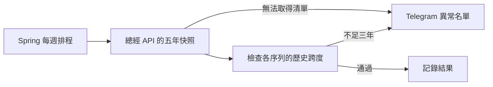

# 產品資料完整性監控與 BPMN

Spring Boot 每週一台北時間 11:00 讀取一次 Maya Sawa 的總經 API，窗口為 60 個月。每條序列以有效、非未來的資料點計算最早到最新的跨度，少於三年或無有效值就回報。Telegram 列出序列代號、名稱、日期與點數；API 失敗另發通知。

## 開發方法

1. 沿用圖表使用的快照，一次請求即可涵蓋 API 回傳的總經序列。檢查實際出圖資料可避免把庫內有資料視為前端已取得資料。
2. 測試不足三年、空資料與正好三年。這個檢查衡量日期跨度，缺日密度、API 未列出的序列及逐圖對照仍需要額外規則。
3. OKE Deployment 從既有 `telegram-notify` Secret 注入 `TELEGRAM_BOT_TOKEN` 與 `TELEGRAM_CHAT_ID`。先驗證資料 API，再部署並確認第一輪排程。可用 `product-integrity.cron=-` 停用。
4. 公開 GET `/tymb/api/business-processes.bpmn` 提供含圖形座標的 BPMN 2.0 XML。使用 BPMN 工具開啟可看到主要業務流程。圖為人工維護的模組概覽，細部規則仍依原始程式與各模組文件。

## 測試

`mvn test -Dtest=MacroHistoryCheckTest`。整合環境需驗證 Telegram 投遞和公開端點。
